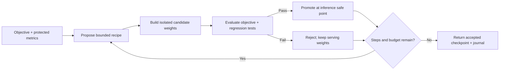

# AutoRSI


[](https://pypi.org/project/autorsi/)

**Bounded, evaluation-gated weight editing for Python applications.** Give AutoRSI a model you control, a measurable objective, protected metrics and a proposer. It builds isolated weight candidates, evaluates them, and promotes accepted weights at an inference safe point. Keep it as a one-shot developer tool or explicitly call it between agent tasks.

AutoRSI is a Python framework for controlled, iterative model improvement. **Version 0.1.0a1 is an MIT-licensed alpha, [available on PyPI](https://pypi.org/project/autorsi/0.1.0a1/):** APIs may change. The source repository and linked source files require repository access while the repository is private.



## Install the alpha

Python 3.11 or newer. The core and scalar demo have no third-party dependencies, provider keys or model downloads:

```sh
python -m pip install autorsi==0.1.0a1
python -m autorsi --output autorsi-runs/demo
```

The demo edits a tiny two-output linear model expressed as scalar weights. It rejects an improvement that damages the protected task, then accepts two bounded improvements. Its target mean squared error goes from `2.5` to `0.625` to `0.0`, while the protected error stays `0.0`. These are deterministic arithmetic examples, not LLM capability results.

For the optional PyTorch backend:

```sh
python -m pip install 'autorsi[torch]==0.1.0a1'
```

## Run from a source checkout

The source examples and development tests require repository access and a checkout. The installed package and its scalar demo do not.

```sh
git clone https://github.com/geniusgeek/autorsi.git
cd autorsi
python -m pip install -e '.[torch]'
```

Run a real PyTorch model edit and reload its exported checkpoint:

```sh
python examples/autorsi/torch_quickstart.py
```

## Integrate your model

Your evaluator returns finite numbers from actual model execution. Choose one objective and as many protected metrics as you need. Select exact editable parameter names and bounds appropriate to your model.

```python
from autorsi import (
    AutoRSI, EditRecipe, Goal, Guard, SequenceProposer,
    TensorEdit, TorchBackend,
)

backend = TorchBackend(
    model,  # Your already loaded torch.nn.Module; the caller's model stays unchanged.
    editable={"target.weight"},
    max_abs_delta=0.1,    # Maximum realized element change per candidate.
    max_total_delta=0.2,  # Maximum total change from construction-time weights.
)

controller = AutoRSI(
    backend=backend,
    evaluator=evaluate,  # Callable: isolated model -> {"task_score": ..., "other_score": ...}
    goal=Goal("task_score", direction="maximize", target=0.95),
    guards=[Guard("other_score", max_regression=0.0)],
    proposer=SequenceProposer([
        EditRecipe((TensorEdit("target.weight", "scale", 0.95),)),
    ]),
    output_dir="autorsi-runs/my-model",
)

result = controller.step()  # At most one proposed edit.
print(result.status, result.metrics, result.checkpoint)

with backend.inference() as serving_model:
    output = serving_model(inputs)
```

[`torch_quickstart.py`](examples/autorsi/torch_quickstart.py) is a complete runnable version. The scale above is an example hypothesis, not a recommended edit for arbitrary models. A proposal is accepted only when the objective strictly improves by at least `min_improvement` and every protected metric passes. An optional `target` stops search once reached; intermediate improvements may be accepted before reaching it.

## Choose an editing LLM

The editor and edited model are independent. `JSONProposer` accepts any configured synchronous transport with the contract `complete(prompt: str) -> str`. You select its provider, model and credentials in your own application. The core makes no network requests.

```python
from autorsi import JSONProposer

proposer = JSONProposer(complete=my_editor_completion)
```

The prompt contains declared goals, metric feedback, allowed parameter names and edit bounds. The response must be one bounded recipe:

```json
{"edits":[{"parameter":"target.weight","operation":"scale","value":0.95}],"rationale":"A testable hypothesis"}
```

Or return `{"stop": true}`. Only scalar `scale` and `add` operations on allowlisted parameters are implemented. Unknown fields, duplicate JSON keys, nonfinite numbers and executable code are rejected. [`json_editor.py`](examples/autorsi/json_editor.py) demonstrates the adapter with an offline transport. Provider-specific clients are intentionally application-owned and have not been validated by this project.

## Optional bounded improvement during agent operation

Use the same controller to preserve its original regression reference across calls. Finish a complete inference/generation operation before requesting a step:

```python
from autorsi import RunLimits

result = controller.run(limits=RunLimits(
    max_steps=4,
    max_accepted=2,
    max_evaluations=10,
    max_seconds=30,
))

# At a later explicit agent task boundary:
result = controller.step(limits=RunLimits(max_evaluations=4, max_seconds=10))

# Restore the predecessor of the most recent accepted edit:
restored_revision = controller.rollback()
```

The host application controls when improvement is triggered and limits the number of calls over its lifetime; each `run` or `step` receives a new budget. See [`agent_loop.py`](examples/autorsi/agent_loop.py). This is a bounded feedback loop over an allowed edit space. It does not invent arbitrary architectures, training procedures or executable self-modifications.

## Accepted weights and evidence

Each run creates a local directory containing an append-only `journal.jsonl`. Candidate checkpoints are written before promotion. `result.checkpoint` identifies the latest **accepted** checkpoint from that run; a staged candidate file alone is not proof of acceptance. The journal records recipe, metrics, decisions, state fingerprints and revisions. Rollback has prepared/committed records.

Torch checkpoints contain only `state_dict` tensors. Recreate the matching architecture, configuration and tokenizer yourself, then load:

```python
state = torch.load(result.checkpoint, map_location="cpu", weights_only=True)
restored_model.load_state_dict(state)
restored_model.eval()
```

A separate `validation_evaluator` can gate candidates with the same metric contract while withholding its numeric feedback from the proposer. Repeated gate decisions still permit adaptive selection; reserve a separate untouched final evaluation if you need a held-out claim.

## Supported scope and limits

- **Implemented:** named scalar reference models and ordinary dense, eager, deepcopy-able PyTorch `nn.Module` models. A tiny random Hugging Face GPT-2 causal LM is tested using real logits and checkpoint reload; install `autorsi[hf-demo]==0.1.0a1` and run `python examples/autorsi/hf_causal_lm.py` from a source checkout. This verifies integration, not language capability improvement.
- **Requires a custom backend:** quantized, distributed, compiled, sharded/offloaded and vLLM runtimes. Editable tied/aliased tensors are rejected. Hosted models without weight access cannot be edited by this backend. No universal model support is claimed.
- **Memory and speed:** correctness-first full model copies, byte fingerprints and CPU edit arithmetic can cost several times the model's memory and substantial time. This backend is suitable for small local models and adapter prototypes, not a production large-model hot-swap system.
- **Inference safety:** use `backend.inference()` for the entire operation and release all asynchronous work before exiting. Do not retain, train or mutate its yielded model. Candidate evaluation is isolated; promotion waits for the lock and refuses stale revisions or expired deadlines. Bypassing this contract removes the safe-point guarantee.
- **Measurement:** protected gates cover only supplied tests and tolerances. They cannot guarantee preservation of unmeasured abilities. Use representative regression suites, fixed evaluation conditions and final held-out tests. No capability improvement is guaranteed.
- **Limits:** evaluation counts include baseline calls. Deadlines are cooperative between synchronous callbacks, and checked again at promotion; they cannot cancel a hung model call or remote provider request. Configure native timeouts and spending limits in your adapters. Bounds also apply to cumulative changes from backend construction weights.
- **Failures:** rejected candidates and pre-promotion failures leave serving weights unchanged. A journal failure after promotion returns `journal_error` with the actual accepted count, checkpoint and revision. An output-directory creation failure raises before any promotion. Rollback reporting errors expose the committed revision via `RollbackJournalError.revision`. Journals are local evidence, not crash-atomic distributed transactions.

See [the integration contract](docs/integration.md) for adapter requirements, revision semantics and evaluator design.

See [the changelog](CHANGELOG.md), [MIT license](LICENSE), and [release procedure](docs/releasing.md). Publishing remains a separate, manual maintainer action.

## Development

```sh
python -m unittest discover -s tests/autorsi -v
```

Torch and Hugging Face integration tests skip when their optional dependencies are absent. With them installed, the suite verifies actual edits/reloads, rejection, protected gates, cumulative bounds, safe-point promotion, stale revisions, deadline handling, rollback and injected storage failures. No test calls a provider or downloads model weights.

## Star History

[](https://star-history.com/#geniusgeek/autorsi&Date)
